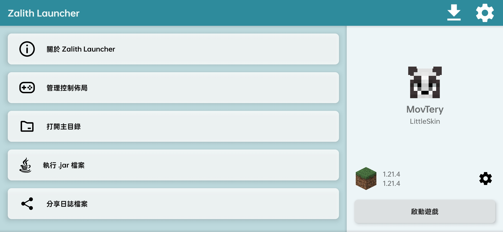
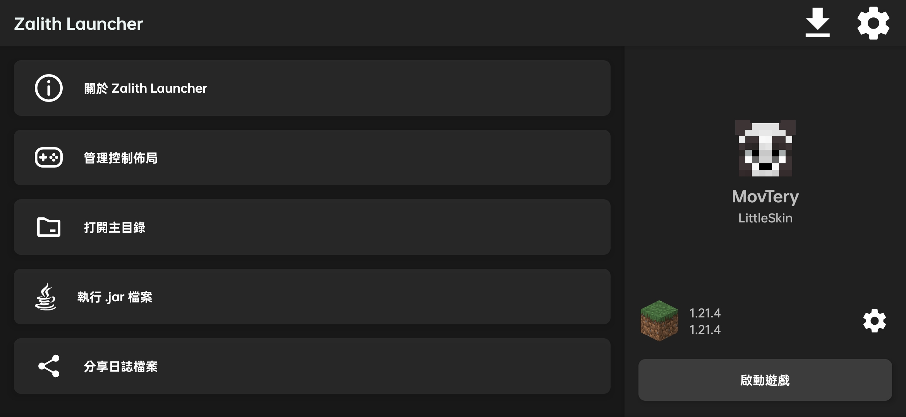
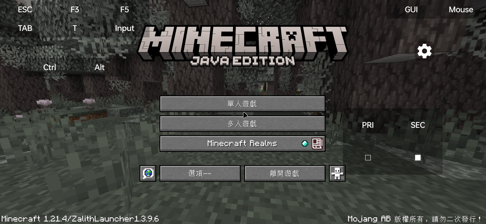

<div align="center">
  
  
  <p><strong>適用於 Android 的 Minecraft: Java 版啟動器</strong></p>

  <p>
    <a href="https://github.com/myzert/YuriLauncher"></a>
    <a href="https://www.gnu.org/licenses/gpl-3.0"></a>
    <a href="https://github.com/myzert/YuriLauncher/actions"></a>
  </p>

  <p>
    <a href="/README.md">English</a> •
    <a href="/README_ZH_CN.md">简体中文</a> •
    <a href="/README-ZH_TW.md">繁體中文</a>
  </p>
</div>

---

## 📖 專案簡介

**Yuri Launcher** 是一款能夠在 Android 設備上運行 Minecraft: Java 版的啟動器，由 **[myzert](https://github.com/myzert)** 獨立維護與開發。

> [!IMPORTANT]
> ### 🌟 鳴謝與致謝 (Credits)
> Yuri Launcher 建立在以下優秀的開源基礎之上：
> - **[ZalithLauncher](https://github.com/ZalithLauncher/ZalithLauncher)** — 原作者：**[MovTery](https://github.com/MovTery)**
> - **[PojavLauncher](https://github.com/PojavLauncherTeam/PojavLauncher)** — 開發團隊：**[PojavLauncherTeam](https://github.com/PojavLauncherTeam)**
> 
> 特別感謝 ZalithLauncher 與 PojavLauncher 的所有作者與開源貢獻者！

---

## ✨ 主要功能

- 🎨 **現代化美觀介面** — 重構佈局設計，支援淺色與深色主題自由切換。
- 📁 **內建檔案管理器** — 輕鬆管理遊戲內部與外部存儲檔案，告別 Android 目錄權限限制。
- ⚡ **更靈活的版本管理** — 支援自訂遊戲目錄位置，靈活配置版本隔離。
- 🎮 **豐富渲染器與插件** — 內建 GL4ES、Vulkan Zink、VirGL 等多種渲染器，支援第三方插件擴展。
- 📦 **啟動器內資源下載** — 直接在啟動器內瀏覽並下載 Mod、模組包、材質包、存檔以及光影。
- 🖱️ **自訂虛擬鍵位** — 自由調整按鍵佈局、虛擬滑鼠與手把映射。
- ☕ **多版本 Java 環境** — 內建 Java 8、17、21，並支援 Java 25 環境。

---

## 📸 應用截圖

| 淺色主題 | 深色主題 | 遊戲運行介面 |
| :---: | :---: | :---: |
|  |  |  |

---

## 🛠️ 從原始碼構建

```bash
# 複製倉庫
git clone https://github.com/myzert/YuriLauncher.git
cd YuriLauncher

# 構建 JRE 組件
./gradlew jre_lwjgl3glfw:build

# 構建 Debug APK
./gradlew YuriLauncher:assembleDebug
```

---

## 👥 貢獻者與致謝

- **主作者 & 維護者:** [myzert](https://github.com/myzert)
- **基於專案:**
  - [ZalithLauncher](https://github.com/ZalithLauncher/ZalithLauncher)（作者：[MovTery](https://github.com/MovTery)）
  - [PojavLauncher](https://github.com/PojavLauncherTeam/PojavLauncher)（團隊：[PojavLauncherTeam](https://github.com/PojavLauncherTeam)）

---

## 📜 開源協議

Yuri Launcher 基於 **GNU General Public License v3.0 (GPL-3.0)** 協議開源。
詳見 [LICENSE](LICENSE) 檔案。
