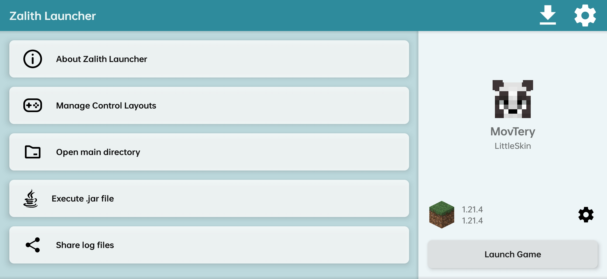
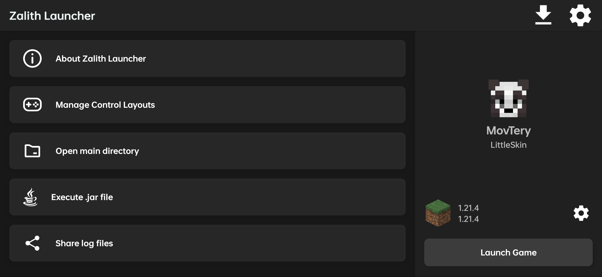
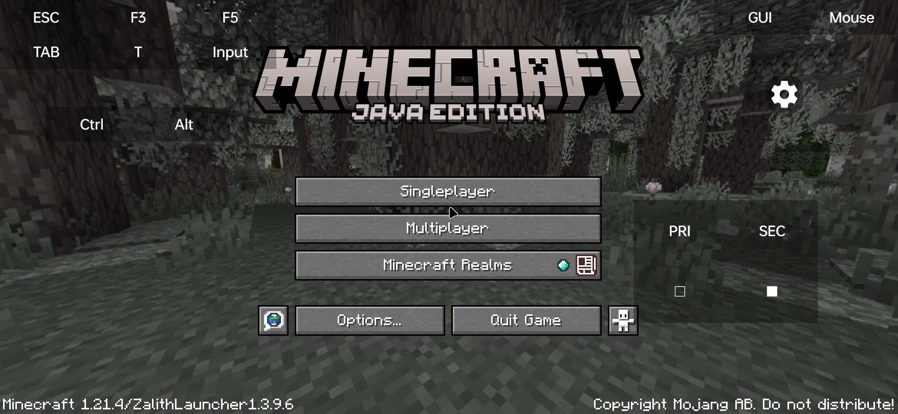

<div align="center">
  
  <br><br>
  
  
  <p><strong>A Next-Generation, High-Performance Minecraft: Java Edition Launcher for Android</strong></p>

  <p>
    <a href="https://github.com/myzert/YuriLauncher/releases/latest"></a>
    <a href="https://github.com/myzert/YuriLauncher/actions/workflows/android.yml"></a>
    <a href="https://www.gnu.org/licenses/gpl-3.0"></a>
    <a href="https://github.com/myzert/YuriLauncher"></a>
    <a href="https://github.com/myzert/YuriLauncher"></a>
  </p>

  <p>
    <a href="#-quick-download">Quick Download</a> •
    <a href="#-performance-optimizations">Optimizers</a> •
    <a href="#-features">Features</a> •
    <a href="#-optimal-settings-guide">Recommended Settings</a> •
    <a href="#-contributors--credits">Credits</a>
  </p>

  <p>
    <a href="/README.md">English</a> •
    <a href="/README_ZH_CN.md">简体中文</a> •
    <a href="/README-ZH_TW.md">繁體中文</a>
  </p>
</div>

---

## 🚀 Quick Download

Get the latest pre-compiled, signed APK directly from GitHub Releases (no zip extraction needed):

| Architecture | Recommended Devices | Direct APK Download |
| :--- | :--- | :---: |
| **`arm64-v8a`** | **Most modern Android phones & tablets (Recommended)** | [📥 **Download APK (arm64)**](https://github.com/myzert/YuriLauncher/releases/download/latest/YuriLauncher-Debug-arm64.apk) |
| **`Universal`** | Contains all runtimes & architectures (All-in-one) | [📥 **Download APK (Universal)**](https://github.com/myzert/YuriLauncher/releases/download/latest/YuriLauncher-Debug-all.apk) |
| **`armeabi-v7a`** | Older 32-bit Android phones | [📥 **Download APK (32-bit)**](https://github.com/myzert/YuriLauncher/releases/download/latest/YuriLauncher-Debug-arm.apk) |
| **`x86_64`** | PC Android Emulators / Intel/AMD 64-bit devices | [📥 **Download APK (x86_64)**](https://github.com/myzert/YuriLauncher/releases/download/latest/YuriLauncher-Debug-x86_64.apk) |
| **`x86`** | 32-bit Android Emulators | [📥 **Download APK (x86)**](https://github.com/myzert/YuriLauncher/releases/download/latest/YuriLauncher-Debug-x86.apk) |

> 💡 *View all release notes and checksums on the [Latest Releases Page](https://github.com/myzert/YuriLauncher/releases/latest).*

---

## ⚡ Performance Optimizations & Engine Tuning

YuriLauncher is engineered for maximum frame rate, low memory overhead, and rock-solid stability on Android:

### 🎮 1. Advanced Graphics & Renderer Engine
- **Built-in MobileGlues Support:** Native integration of MobileGlues (OpenGL 4.0 to GLES 3.2 translation) without requiring any third-party launcher plugin.
- **Multithreaded OpenGL (`mesa_glthread=true`):** Offloads OpenGL call submission to a secondary worker thread, dramatically reducing CPU bottlenecks.
- **Turbo Turnip Driver (`TU_DEBUG=noconform`):** Bypasses strict conformance checks on Qualcomm Snapdragon (Adreno) GPUs to unlock higher FPS.
- **Massive 500MB Shader Cache (`MESA_GLSL_CACHE_MAX_SIZE=500MB`):** Pre-caches compiled shaders locally to eliminate chunk generation stutter and shader hitching.
- **Smooth Presentation (`MESA_VK_WSI_DEBUG=swapsync`):** Aligns Vulkan swapchain intervals to prevent micro-stuttering.

### 🧠 2. Low-Latency Garbage Collection (GC)
- **Tuned G1GC Engine:** Tuned heap parameters (`-XX:G1NewSizePercent=20 -XX:G1ReservePercent=15 -XX:MaxGCPauseMillis=50 -XX:G1HeapRegionSize=32M`) to prevent GC spikes during high-speed world exploration.
- **Multithreaded Parallel Processing:** Enables `-XX:+ParallelRefProcEnabled` and full 8-core CPU affinity utilization (`-XX:ActiveProcessorCount=8`).

### 🛡️ 3. Sandbox Crash Prevention
- **Writable Native Tmpdir:** Automatically routes `-Djna.tmpdir=`, `-Dorg.lwjgl.system.SharedLibraryExtractPath=`, and `-Dio.netty.native.workdir=` into the app's internal writable sandbox, resolving the infamous `AccessDeniedException` on Minecraft 1.21+ / snapshots.

---

## ✨ Features

- 💜 **Material 3 Purple Palette** — Elegant, user-customizable dark and light theme options.
- ⚡ **Seamless Version Management** — Supports Minecraft Java from alpha versions up to the latest releases, snapshots, and April Fools builds.
- 🧩 **Comprehensive Mod Loader Support** — One-click installation and automatic management for:
  - **Fabric** & **Quilt**
  - **Forge** & **NeoForge**
  - **OptiFine** & **Iris / Sodium**
- 📦 **In-App Content Downloader** — Browse and download CurseForge & Modrinth mods, modpacks, resource packs, and shaders directly inside the app.
- 🎮 **Pro Virtual Touch Controls** — Fully customizable button layouts, virtual mouse, multi-touch gestures, and external physical gamepad support.
- ☕ **Pre-packaged Java Runtimes** — Includes clean runtimes for **Java 8**, **Java 17**, **Java 21**, with experimental support for **Java 25**.
- 🎬 **Native ReplayMod & FFmpeg Support** — Ready for video export with Pojav FFmpeg integration.

---

## 📸 Screenshots

| Light Theme | Dark Theme | In-Game Overlay |
| :---: | :---: | :---: |
|  |  |  |

---

## 📋 Recommended Settings Guide

To get the best performance for your device:

| Device Type | Recommended Renderer | Recommended RAM | Mod Recommendation |
| :--- | :--- | :--- | :--- |
| **Snapdragon (Adreno 6xx/7xx)** | **MobileGlues** or **Vulkan Zink** (with Turnip driver) | `2048 MB` – `4096 MB` | Fabric + Sodium + Lithium + FerriteCore |
| **MediaTek (Mali GPU)** | **MobileGlues** or **GL4ES** | `2048 MB` – `3500 MB` | Fabric + Sodium / Embeddium |
| **Exynos / Kirin** | **MobileGlues** | `2048 MB` – `3072 MB` | Fabric + Sodium |
| **Older Android (<= Android 10)** | **GL4ES** | `1024 MB` – `2048 MB` | OptiFine or Sodium 1.16.5 |

---

## 🛠️ Building From Source

### Requirements
- **JDK 17** or newer
- **Android SDK** (API 34) & **NDK** (25.2.9519653)
- **Git**

### Build Commands
```bash
# Clone the repository
git clone https://github.com/myzert/YuriLauncher.git
cd YuriLauncher

# Build JRE runtime libraries
./gradlew jre_lwjgl3glfw:build --no-daemon

# Build Debug APK (with com.YuriLauncher package ID)
./gradlew YuriLauncher:assembleDebug

# Build for a specific architecture (e.g. arm64)
./gradlew YuriLauncher:assembleDebug -Darch=arm64
```
*Generated APKs are located at `YuriLauncher/build/outputs/apk/debug/`.*

---

## 👥 Contributors & Credits

YuriLauncher is proudly built upon and inspired by extraordinary open-source projects:

### 🌟 Core Contributors
| Contributor | Role & Contribution | Profile / Repository |
| :--- | :--- | :--- |
| **[myzert](https://github.com/myzert)** | Lead Creator, Rebranding, Optimizations & Maintainer | [](https://github.com/myzert) |
| **[MovTery](https://github.com/MovTery)** | Creator of ZalithLauncher, Original Architecture & Design | [](https://github.com/MovTery) |
| **[PojavLauncherTeam](https://github.com/PojavLauncherTeam)** | PojavLauncher Core, Minecraft Java Android Engine | [](https://github.com/PojavLauncherTeam/PojavLauncher) |
| **[MobileGL-Dev](https://github.com/MobileGL-Dev)** | MobileGlues OpenGL ES translation layer | [](https://github.com/MobileGL-Dev/MobileGlues-release) |
| **[FCL-Team](https://github.com/FCL-Team)** | FoldCraftLauncher renderer plugins & extensions | [](https://github.com/FCL-Team) |
| **[Vera-Firefly](https://space.bilibili.com/1412062866)** | UI/UX & Visual Contributions | [Bilibili Space](https://space.bilibili.com/1412062866) |
| **[ShirosakiMio](https://space.bilibili.com/35801833)** | Launcher Components & Native Utilities | [Bilibili Space](https://space.bilibili.com/35801833) |

### 💖 Upstream Acknowledgements
- **[HMCL](https://github.com/HMCL-dev/HMCL)** — Hello Minecraft! Launcher
- **[Caciocavallo](https://github.com/PojavLauncherTeam/caciocavallo)** — AWT Android integration
- **[LWJGL](https://www.lwjgl.org/)** — Lightweight Java Game Library

---

## 📜 License

Yuri Launcher is open-source software licensed under the **GNU General Public License v3.0 (GPL-3.0)**.  
See the [LICENSE](LICENSE) file for more information.
