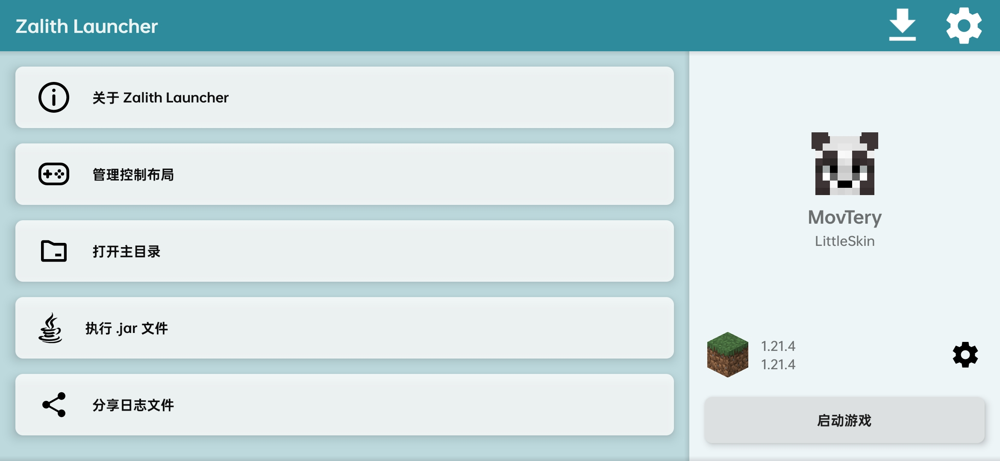
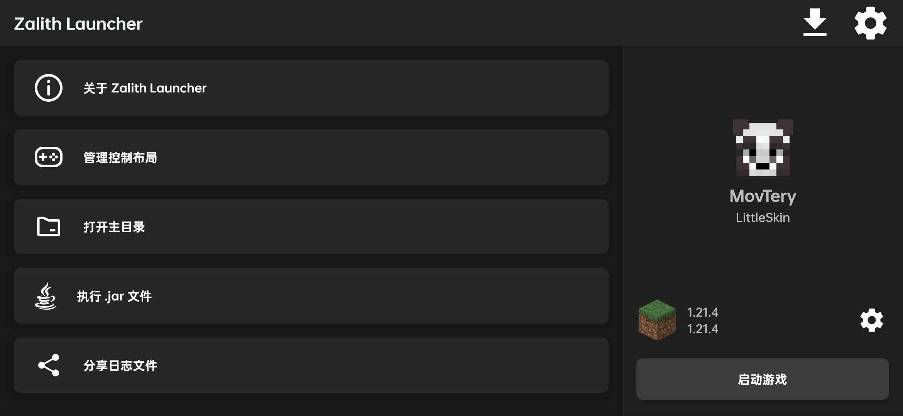
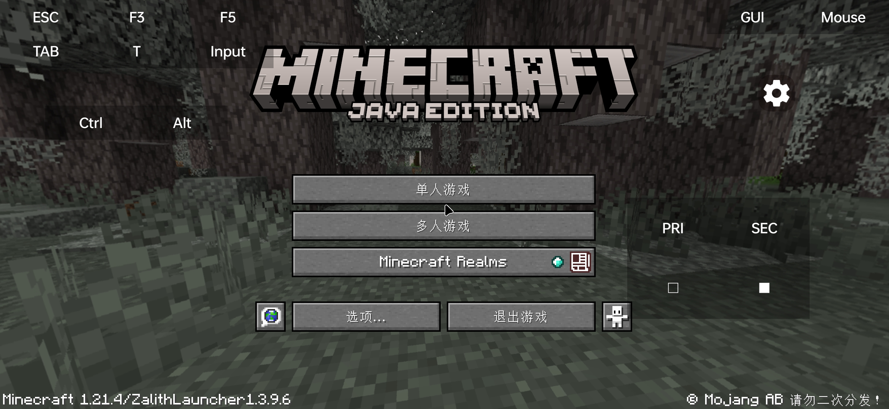

<div align="center">
  
  
  <p><strong>适用于 Android 的 Minecraft: Java 版启动器</strong></p>

  <p>
    <a href="https://github.com/myzert/YuriLauncher"></a>
    <a href="https://www.gnu.org/licenses/gpl-3.0"></a>
    <a href="https://github.com/myzert/YuriLauncher/actions"></a>
  </p>

  <p>
    <a href="/README.md">English</a> •
    <a href="/README_ZH_CN.md">简体中文</a> •
    <a href="/README-ZH_TW.md">繁體中文</a>
  </p>
</div>

---

## 📖 项目简介

**Yuri Launcher** 是一款能够在 Android 设备上运行 Minecraft: Java 版的启动器，由 **[myzert](https://github.com/myzert)** 独立维护与开发。

> [!IMPORTANT]
> ### 🌟 鸣谢与致谢 (Credits)
> Yuri Launcher 建立在以下优秀的开源基础之上：
> - **[ZalithLauncher](https://github.com/ZalithLauncher/ZalithLauncher)** — 原作者：**[MovTery](https://github.com/MovTery)**
> - **[PojavLauncher](https://github.com/PojavLauncherTeam/PojavLauncher)** — 开发团队：**[PojavLauncherTeam](https://github.com/PojavLauncherTeam)**
> 
> 特别感谢 ZalithLauncher 与 PojavLauncher 的所有作者与开源贡献者！

---

## ✨ 主要功能

- 🎨 **现代化美观界面** — 重构布局设计，支持明亮与暗色主题无缝切换。
- 📁 **内置文件管理器** — 轻松管理游戏内部与外部存储文件，告别 Android 目录权限限制。
- ⚡ **更灵活的版本管理** — 支持自定义游戏目录位置，灵活配置版本隔离。
- 🎮 **丰富渲染器与插件** — 内置 GL4ES、Vulkan Zink、VirGL 等多种渲染器，支持第三方插件扩展。
- 📦 **启动器内资源下载** — 直接在启动器内浏览并下载 Mod、整合包、材质包、存档以及光影。
- 🖱️ **自定义虚拟键位** — 自由调整按键布局、虚拟鼠标与手柄映射。
- ☕ **多版本 Java 环境** — 内置 Java 8、17、21，并支持 Java 25 环境。

---

## 📸 应用截图

| 浅色主题 | 深色主题 | 游戏运行界面 |
| :---: | :---: | :---: |
|  |  |  |

---

## 🛠️ 从源码构建

```bash
# 克隆仓库
git clone https://github.com/myzert/YuriLauncher.git
cd YuriLauncher

# 构建 JRE 组件
./gradlew jre_lwjgl3glfw:build

# 构建 Debug APK
./gradlew YuriLauncher:assembleDebug
```

---

## 👥 贡献者与致谢

- **主作者 & 维护者:** [myzert](https://github.com/myzert)
- **基于项目:**
  - [ZalithLauncher](https://github.com/ZalithLauncher/ZalithLauncher)（作者：[MovTery](https://github.com/MovTery)）
  - [PojavLauncher](https://github.com/PojavLauncherTeam/PojavLauncher)（团队：[PojavLauncherTeam](https://github.com/PojavLauncherTeam)）

---

## 📜 开源协议

Yuri Launcher 基于 **GNU General Public License v3.0 (GPL-3.0)** 协议开源。
详见 [LICENSE](LICENSE) 文件。
